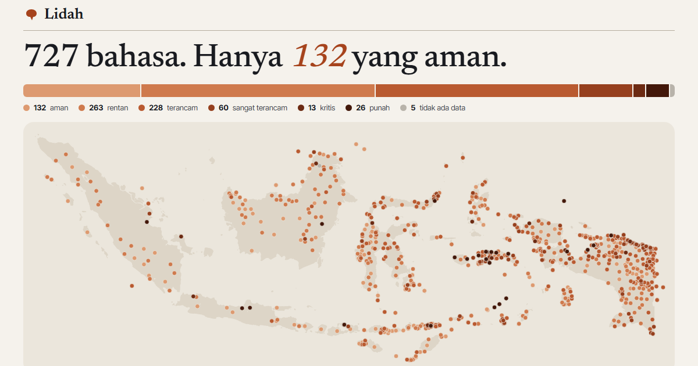

# Lidah



**[Buka Lidah](https://lidah.raffstw.my.id)**

Peta 727 bahasa ibu yang dituturkan di Indonesia, dari data
[Glottolog](https://glottolog.org) 5.2.1. Hanya 132 di antaranya yang aman; sisanya rentan,
terancam, atau sudah punah.

- **Peta setiap bahasa**, diwarnai menurut status keterancaman atau rumpun (Austronesia lawan
  Papua). Ketuk titiknya untuk silsilah dan rincian bahasa itu.
- **Per wilayah**: komposisi status di tujuh wilayah. Papua sendiri punya 283 bahasa, dan 59%
  di antaranya terancam atau punah.
- **Di sekitar daerahmu**: delapan bahasa yang titiknya paling dekat dengan kabupaten/kota
  pilihanmu.
- **Rumpun**: 463 bahasa Austronesia, dan 264 sisanya terbagi ke puluhan rumpun Papua yang
  tidak terbukti berkerabat, ditambah bahasa isolat.
- **Cari bahasa**: silsilah lengkap dari rumpun teratas, status, tingkat dokumentasi, dan
  negara lain tempat bahasa itu dituturkan. Bisa dicari dengan nama Indonesia, nama Glottolog,
  atau kode ISO 639-3.

## Data

`npm run data` mengunduh `languages.csv` dan `values.csv` dari rilis CLDF Glottolog v5.2.1,
mengambil languoid tingkat bahasa berkategori bahasa ibu lisan yang tercatat di Indonesia,
lalu menyimpan ringkasannya di `data/mentah/glottolog-id.json`. Tanpa `--unduh`, skrip memakai
ringkasan itu.

| | Sumber |
|---|---|
| Bahasa, koordinat, klasifikasi, status, dokumentasi | Hammarström, Forkel, Haspelmath & Bank. 2025. Glottolog 5.2.1. MPI-EVA. CC BY 4.0 |
| Batas dan titik tengah kabupaten/kota | geoBoundaries ADM2 (BPS, WFP, OCHA ROAP; CC BY 3.0 IGO) |

Status adalah Agglomerated Endangerment Status Glottolog dengan nama mengikuti padanan
istilah UNESCO (aman, rentan, terancam, sangat terancam, kritis, punah). Wilayah ditentukan
dari kabupaten/kota terdekat dengan titik bahasa. Glottolog hanya menyimpan satu titik per
bahasa, jadi bahasa besar seperti Jawa dituturkan jauh melampaui titiknya.

## Warna

Status memakai skala urut satu rona, rumpun memakai dua warna kategorikal; keduanya
divalidasi untuk mode terang dan gelap serta untuk buta warna.

## Menjalankan

```
npm install
npm run dev
npm test
npm run build
```

Vite + TypeScript, tanpa framework UI; peta dengan d3-geo dan topojson-client.
